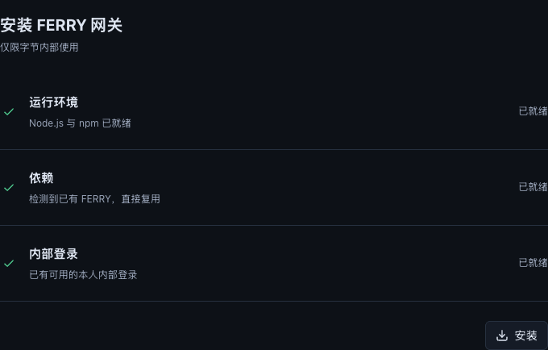
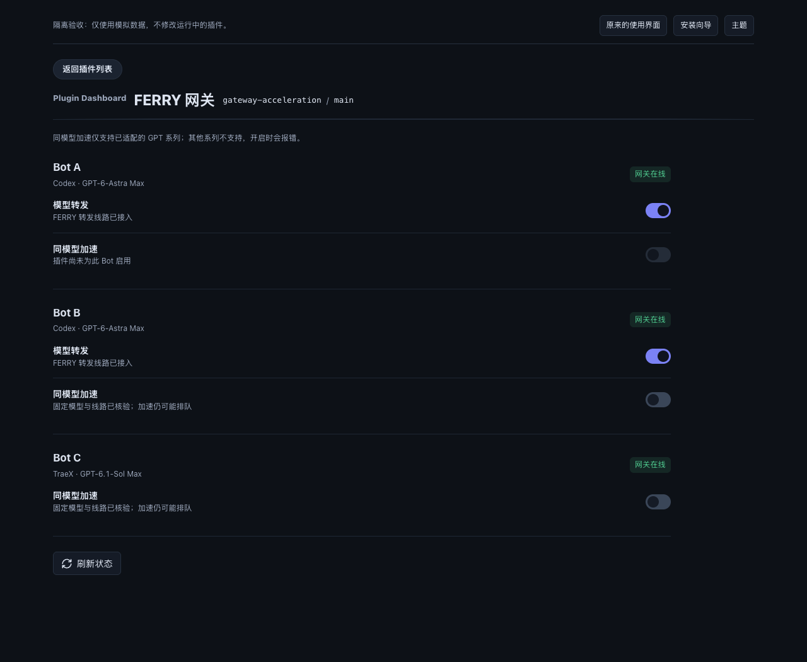

# FERRY 网关

Botmux 插件评审候选代码，面向已有内部 FERRY 使用权限的用户。

**这是第三方评审候选，不是官方发布，也没有登记为可安装的市场条目。**
尚未发布 npm，包保留 `private: true` 与占位名称，防止误发布。
不包含 FERRY 源码、网关凭据、个人 Bot 配置或本机启动脚本。

## 交互与实现

- 原生插件管理页继续管理全局及逐 Bot 启用范围。
- 安装页自动检查当前环境，不选择 Bot：运行环境、依赖、内部登录三个纵向条目。
- 缺失 Node.js/npm 或 FERRY 时显式点击一键补足；已有依赖复用。
- Codex 提供模型转发与同模型加速两个独立控制；已验证的 TraeX 适配只显示加速。
- 同模型加速仅支持已适配的固定 GPT 模型；其他模型拒绝，实验性自动选模不混用。
- 后台保留权限、实际线路、模型与档位检查，不承诺零排队。




## 发布前仍需完成

1. **安装页宿主接入**：`installation/` 是单独验证过的安装协调器和页面源码；
   目前没有在正式 Botmux 插件市场安装入口注册。普通安装 `gateway/` 不会自动
   得到截图中的安装前页面，需官方确定接入合同。
2. **新环境自动适配**：受管启动器已经实现，但不会自动接管任意已有 CLI wrapper。
   必须建立并核验真实客户端入口、模型映射、档位、会话目录和网关控制适配记录。
3. **原生 FERRY 加速控制**：当前支持已审计的独立 flag 控制，不存在已验证的
   通用原生 FERRY 自动加速接口。新装 FERRY 不等于自动具备此插件的加速控制。
4. **分发方式**：内部 FERRY 依赖从内部 registry 获取，需要本人认证。
   官方目录目前要求先有公开可读的 npm 包；内部依赖插件的收录方式及最终 namespace
   需确认。没有 `@botmux-ai` 的发布权限时不能使用官方 scope 冒充官方包。

因此，这个仓库供接口、代码和交互评审，不应作为“任意机器安装即用”的正式发布。

## 开发验证

需要 Node.js 22+：

```bash
npm ci --ignore-scripts
npm run build
npm test
npm run test:package
```

测试使用临时目录、模拟网络和子进程适配器，不会修改真实 Bot 配置、登录、
启动推理或重启现有网关。打包验证会从真实 tarball 解压并在临时 HOME 加载后端，
检查包不含 `node_modules`、源码、个人配置或内部 FERRY 实现。

## 目录

| 目录 | 用途 |
| --- | --- |
| `gateway/src` | Dashboard、状态、独立控制、运行环境与依赖准备、受管启动器 |
| `gateway/skills` | 网关操作边界 |
| `shared` | 私有状态写入、锁和 UI 基础组件 |
| `installation` | 待宿主接入的三项安装检查与页面 |
| `test` | 不接触真实环境的行为测试 |
| `docs/screenshots` | 匿名模拟数据截图 |

`gateway/dist` 是构建输出，不提交到 git；构建后可本地 `npm pack ./gateway` 做审计，
这不会发布 npm，也不会把安装前宿主集成伪装为已完成。

## 安全边界

- 插件以运行 Botmux 的本机用户权限执行，依赖准备须显式操作。
- Node.js 使用官方固定版本与 SHA-256 校验；FERRY 使用固定版本与 SHA-512 校验。
- 安装目录独立于插件包，不覆盖全局依赖，不执行 npm 生命周期脚本。
- 内部登录由官方 FERRY 登录流程完成，不复制或输出 token。
- 开关不迁移既有会话历史，不取消在途推理；受管启动器保留已记录的 provider。
- 仅已审计的独立加速控制可写入；未知或与模型切换耦合的旧开关不接管。

## 官方入口

- [插件开发与发布文档](https://github.com/deepcoldy/botmux/blob/master/docs-site/docs/zh/plugins.md)
- [官方插件组织](https://github.com/botmux-ai)
- [独立插件目录](https://github.com/botmux-ai/plugin-market)
- [原生插件页独立 PR](https://github.com/deepcoldy/botmux/pull/2999)

目录收录是发现机制，不自动代表官方维护或安全背书。
